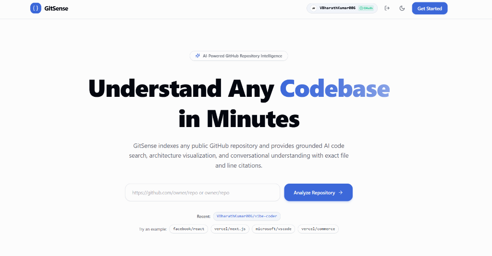
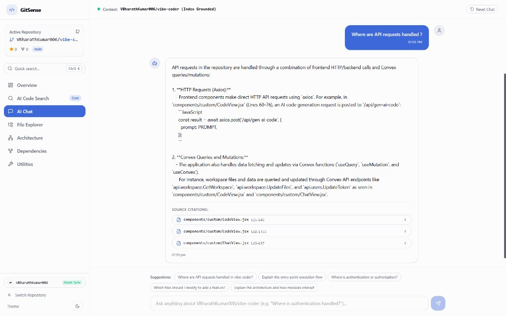
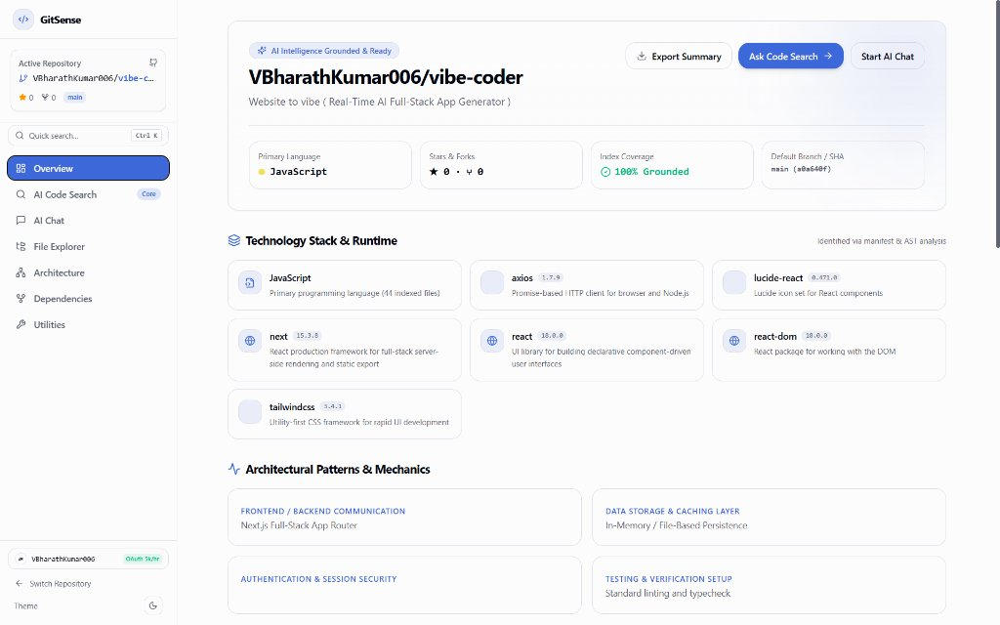

# GitSense

An AI-powered GitHub repository intelligence platform. Paste any public GitHub repository URL and get grounded AI code search, architecture visualization, conversational understanding, and a full repository overview with exact file and line citations.

**Core Principle:** Every answer about repository code is strictly grounded in actual indexed source files. Nothing is fabricated or assumed.



## Features

### AI Code Search (Core)

Natural language queries against indexed repository code. Ask questions like "Where are API requests handled?" or "Which file manages authentication?" and receive a synthesized answer with exact file paths and line ranges (e.g. `L18-L42`), syntax-highlighted code snippets, and one-click copy.

Results are ranked using hybrid retrieval that blends vector similarity embeddings with keyword and symbol scoring.

### Repository AI Chat

Multi-turn conversational assistant grounded in the indexed repository. Ask follow-up questions and the assistant maintains context across the conversation while citing specific files and functions.



### AI Repository Overview

Automated analysis of the repository's purpose, technology stack, runtime dependencies, architectural patterns, key modules, and execution entry points. Detected via manifest files and AST-level inspection.



### Architecture Visualization

Interactive Mermaid diagrams showing system architecture and execution flow. Nodes link directly to the corresponding source files in the code viewer.

### Dependency and Module Explorer

Import/export relationship graph that maps incoming and outgoing dependencies. Identifies high-centrality hub modules and leaf modules with an interactive inspector.

### File Explorer and Code Viewer

Collapsible directory tree with an integrated code viewer. Supports line numbers, file statistics, and direct navigation from search results, chat citations, and architecture nodes.

### Developer Utilities

- Environment variable audit (detects expected configuration without leaking secrets)
- Symbol and export finder across the indexed codebase
- API route extractor for Next.js, Express, and Fastify projects
- Security diagnostics for hardcoded tokens and insecure dependencies
- Circular dependency detection across modules

### Additional Capabilities

- Global command palette (`Ctrl+K`) for instant file search and page navigation
- One-click markdown architecture export for PR descriptions and documentation
- GitHub OAuth authentication increasing API limits to 5,000 requests per hour
- Dark and light theme support
- Resilient Gemini model failover chain with automatic model switching

## Technology Stack

| Layer | Technology | Purpose |
|-------|-----------|---------|
| Framework | Next.js 15 (App Router) | Full-stack architecture with React Server Components and API routes |
| Language | TypeScript (strict mode) | End-to-end type safety |
| Styling | Tailwind CSS v4 | Dark-first developer UI with CSS custom properties |
| UI | Lucide React | Icon system and accessible UI primitives |
| Diagrams | Mermaid.js | Client-side architecture diagram rendering |
| AI and Embeddings | Google Gemini (Flash Lite, gemini-embedding-001) | Grounded code reasoning and vector embeddings with automatic model failover |
| Vector Store | In-memory cosine similarity engine | High-performance embedded vector indexing with hybrid retrieval |
| GitHub Access | GitHub REST v3 API | Repository metadata, recursive git trees, and raw file content |
| CI/CD | GitHub Actions, Docker, Vercel | Automated typecheck, testing, and deployment |

## Getting Started

### Prerequisites

- Node.js 20 or 22+
- npm
- (Recommended) Google Gemini API key for dynamic AI features
- (Recommended) GitHub Personal Access Token for increased API rate limits

### Installation

```bash
git clone https://github.com/VBharathKumar006/GitSense.git
cd GitSense
npm install
cp .env.example .env.local
```

### Environment Configuration

Edit `.env.local` with your keys:

```env
# Recommended: Google Gemini API key for AI code search and chat
# Get a free key at https://aistudio.google.com/app/apikey
GEMINI_API_KEY=your_gemini_api_key_here

# Recommended: GitHub personal access token (increases rate limit to 5,000 req/hr)
# Generate at https://github.com/settings/tokens (select "public_repo" scope)
GITHUB_TOKEN=your_github_personal_access_token

# Optional: GitHub OAuth App credentials for browser login
GITHUB_CLIENT_ID=
GITHUB_CLIENT_SECRET=

# Optional: PostgreSQL + pgvector connection string for persistent vector storage
DATABASE_URL=

# Application URL
NEXT_PUBLIC_APP_URL=http://localhost:3000
```

If `GEMINI_API_KEY` is not provided, GitSense operates in offline mode using embedded cosine vector matching and AST-powered heuristics. AI-synthesized answers require a valid Gemini key.

### Running Locally

```bash
npm run dev
```

Open [http://localhost:3000](http://localhost:3000) in your browser.

### Optional: PostgreSQL + pgvector

For persistent relational vector indexing:

```bash
psql -d gitsense -f scripts/init-pgvector.sql
```

## Testing

The project includes 16 automated unit tests covering URL parsing, vector cosine similarity, keyword scoring, file filtering, tree construction, pgvector formatting, branch fallback resolution, line-exact code chunking, multi-language symbol extraction, and an AI search evaluation benchmark.

```bash
# Run unit tests
npm test

# TypeScript type check
npm run typecheck

# Production build
npm run build
```

## Deployment

### Vercel (Recommended)

1. Push the repository to GitHub (already done).
2. Import the project at [vercel.com/new](https://vercel.com/new).
3. Add your environment variables (`GEMINI_API_KEY`, `GITHUB_TOKEN`, `NEXT_PUBLIC_APP_URL`) in the Vercel dashboard.
4. Deploy.

### Docker

A multi-stage production Dockerfile is included:

```bash
docker build -t gitsense:latest .
docker run -p 3000:3000 --env-file .env.local gitsense:latest
```

## Project Structure

```
GitSense/
├── .github/workflows/ci.yml              CI pipeline (typecheck, test, build)
├── docs/screenshots/                      Application screenshots
├── scripts/init-pgvector.sql              PostgreSQL + pgvector schema
├── src/
│   ├── app/
│   │   ├── api/
│   │   │   ├── ai/health/route.ts         AI connectivity health check
│   │   │   ├── auth/                      GitHub OAuth login, callback, logout
│   │   │   └── repo/[owner]/[name]/
│   │   │       ├── architecture/route.ts  Architecture diagram synthesis
│   │   │       ├── chat/route.ts          Conversational AI endpoint
│   │   │       ├── dependencies/route.ts  Dependency analysis
│   │   │       ├── file/route.ts          Raw file content retrieval
│   │   │       ├── info/route.ts          Repository metadata
│   │   │       ├── overview/route.ts      AI overview synthesis
│   │   │       ├── search/route.ts        Grounded code search
│   │   │       ├── tree/route.ts          Recursive file tree
│   │   │       └── utilities/route.ts     Developer utility endpoints
│   │   ├── repo/[owner]/[name]/
│   │   │   ├── page.tsx                   Repository overview dashboard
│   │   │   ├── search/page.tsx            AI Code Search page
│   │   │   ├── chat/page.tsx              AI Chat page
│   │   │   ├── explorer/page.tsx          File explorer and code viewer
│   │   │   ├── architecture/page.tsx      Architecture visualizer
│   │   │   ├── dependencies/page.tsx      Dependency explorer
│   │   │   ├── utilities/page.tsx         Developer utilities
│   │   │   └── layout.tsx                 Dashboard layout with sidebar
│   │   ├── page.tsx                       Landing page
│   │   └── layout.tsx                     Root layout with theme provider
│   ├── components/
│   │   ├── dashboard/command-palette.tsx   Global Ctrl+K command palette
│   │   ├── landing/                       Hero, Navbar, Features, Footer
│   │   ├── providers/theme-provider.tsx   Dark/light theme management
│   │   └── ui/                            Reusable UI primitives
│   ├── lib/
│   │   ├── ai/gemini.ts                   Gemini API client with model failover
│   │   ├── auth/github.ts                 OAuth token management
│   │   ├── github/api.ts                  GitHub REST client with caching
│   │   ├── indexing/analyzer.ts           Repository analysis pipeline
│   │   ├── indexing/parser.ts             Multi-language symbol extractor
│   │   ├── search/pgvector.ts             PostgreSQL vector queries
│   │   └── search/vector-store.ts         Hybrid retrieval engine
│   └── types/repository.ts               Core TypeScript domain models
├── tests/core.test.ts                     16 unit tests (Node.js test runner)
├── Dockerfile                             Multi-stage production container
├── plan.md                                Project plan and progress audit
└── decisions.md                           Architectural decision records
```

## Security

1. **No code execution.** Repository source files are analyzed as text only and never executed.
2. **Prompt injection protection.** Repository code is wrapped in `<untrusted_repository_code>` delimiters with strict system instructions that reject any prompt overrides found inside source files.
3. **API key isolation.** Gemini API keys and GitHub tokens remain server-side in API routes. They are never exposed to client browsers.
4. **Input validation.** Regex-based URL validation and path traversal checks on all file requests.
5. **Secret-safe environment handling.** `.env.local` is git-ignored. Only `.env.example` with placeholder documentation is tracked.

## License

MIT
